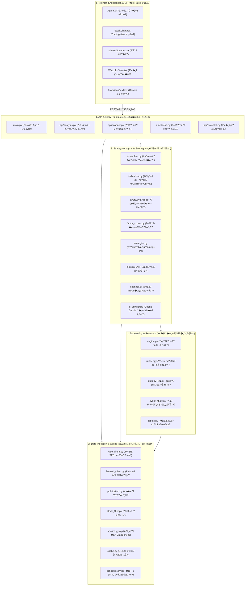

# ?°è‚¡æ³¢æ®µç­–ç•¥?†æ??€ ???°äººä¸Šæ??‡æ�¶æ§‹æ?å¼?(Onboarding Guide)

æ­¡è?? å…¥ **?°è‚¡æ³¢æ®µç­–ç•¥?†æ??€ (Taiwan Stock Swing Strategy Analyzer)** ?‹ç™¼?˜é?ï¼? 
?¬æ??—基?¼ç³»çµ±çŸ¥è­˜å?è­œï?Knowledge Graph）ç??�ï??¨åœ¨å¹«åŠ©?°é€²å·¥ç¨‹å¸«?¨æ??­æ??“å…§?Œæ�¡?¨å?案ç?業å??®æ??�核心æ�¶æ§‹ã€�é??µè¨­è¨ˆå??‡è??¬åœ°?‹ç™¼æµ�ç???
---

## 1. å°ˆæ?概è? (Project Overview)

?°è‚¡æ³¢æ®µç­–ç•¥?†æ??€?¯ä?套å???*?°è‚¡ä¸Šå??‡ä?櫃普?šè‚¡**設è??„波段交?“ç??¥å??�ã€�å?? å?起漲評å??‡æ­·?²å?æ¸?Web ?‰ç”¨å·¥å…·??
### ?¸å??¹å€¼è?設è??²å­¸
- **?œç??ªä??½æ•¸?�å·® (Zero Lookahead Bias)**：嚴?¼è�½å¯?*é»�æ?æ­?¢º??(Point-in-Time Correctness)**，æ??Ÿæ”¶ä»¥æ¬¡??0?¥æ?定公?Šæ—¥?ºåŸºæº–ï?財å?å­? ±ä»¥å…¬?Šæˆªæ­¢æ—¥?–實?›å…¬?Šæ—¥?Ÿæ?，ç?止在歷å�²?‹ç?中使?¨ã€Œç•¶ä¸‹å??ªå…¬ä½ˆã€�ç??ªä?資æ???- **三層檢é?體系**：ç??ˆã€ŒåŸº?¬é�¢?¥åº·åº¦ã€�ã€�「æ?人ç?碼å??Šã€�è??Œæ?è¡“é�¢æ³¢æ®µ?‹æ??�ä?層æ??œï??ªæ??Œæ??šé?三層檢核?„æ??„æ??·å?實盤交æ??¹å€¼ã€?- **實è?多å?å­�è???(Empirical Factor Scoring)**：基??5 å¹´ï?2021-2024）å??‘ä??œç?事件?”究，以客è?çµ±è??�ç??�å?幅度（Lift）è?ç·´ç?é©—æ??�ï??œç?主è??œæ¸¬??- **?°è‚¡?‡é??®ä?ç²¾ç?法è? (Tick-Size Compliance)**：進出?´é?ä½�以 14 ??ATR ?ºåŸºæº–ï??œæ? -2 ATR?�å???+3 ATR）ï?並ä??°è‚¡æ³•è??¡åƒ¹ç´šè??ªå??›æ�¨äº”å…¥?³æ?準å??�æ?ä½�ã€?
### ?€è¡“棧 (Tech Stack)
- **後端 (Backend)**: Python 3.12?�FastAPI?�pandas?�NumPy?�SQLite?�[uv](https://docs.astral.sh/uv/)（極??Python 套件管ç??¨ï??�APScheduler
- **?�端 (Frontend)**: React 19?�TypeScript?�Vite?�Tailwind CSS?�TradingView Lightweight Charts
- **測試框æ�¶**: ?�端 `pytest`（è??‹ç?高ã€�å�« Mock Fixtures）ã€�å?ç«?`Vitest` + React Testing Library

---

## 2. 系統?¶æ??‡ä?大å?å±?(Architecture Layers)

系統?ƒå??ºè�·è²¬æ??°ç?七大?¶æ?層ï?層è?層ä??“ä?è³´æ–¹?‘自上而ä??®å?æµ�å?ï¼?


---

## 3. ?¸å?設è??Ÿå??‡æ¥­?™è???(Key Concepts & Rules)

?°é€²é??¼è€…在?±è??‡ä¿®?¹ç?å¼�碼?‚ï?å¿…é??¹åˆ¥?™æ?以ä??¸å?è¦�ç?ï¼?
### 1. é»�æ?æ­?¢º??(Point-in-Time Correctness)
- 模ç?：[`backend/app/data/publication.py`](../backend/app/data/publication.py) ??[`backend/app/analysis/layers.py`](../backend/app/analysis/layers.py)
- **?Ÿå?**：進è?æ­·å�²?�測?‡é€�æ—¥?‡æ??ˆä½µ?‚ï?**?´ç?使用 `merge(on='date')` ?´é€?²¡??*??- **作æ?**：ç??¶è?財報記é?å¿…é?帶æ? `effective_date`，並一律é€�é? `pd.merge_asof(direction='backward')` 將交?“æ—¥?‡ã€Œè©²?¥ç•¶ä¸‹å·²?Ÿæ?之æ??°è²¡?±ã€�å?齊ã€?
### 2. ?°è‚¡?®é€šè‚¡?´æ ¼?�濾
- 模ç?：[`backend/app/data/stock_filter.py`](../backend/app/data/stock_filter.py)
- **?Ÿå?**：系統å??¯æ�´**?°ç�£è­‰åˆ¸äº¤æ??€ (上å?)** ??**證券櫃檯買賣中å? (上æ?)** ä¹?*?®é€šè‚¡**??- **?’除標ç?**：è?櫃股ç¥?(`emerging`)?�ETF/ETN（代??`00xxx`, `01xxx`, `02xxx`）ã€�æ?è­‰ã€�å?託æ?è­‰å??¹åˆ¥?¡ã€?
### 3. 三層檢é?模å??€æª?- 模ç?：[`backend/app/analysis/layers.py`](../backend/app/analysis/layers.py)
- **?ºæœ¬?¢å±¤**ï¼?  - ?ˆç??¶å¹´å¢�ç? (YoY) > 0%
  - è¿‘å?å­?EPS 總å? > 0 ??  - 負債比ç? ??60%
- **籌碼?¢å±¤**ï¼?  - 10 ?¥å?資è??•ä¿¡?ˆè?è²·è? > 0 å¼?  - 10 ?¥è?資å?å¹…å??†ï??¡æ•£?¶ç?碼å?亂失?§æ?æ³?- **?€è¡“é�¢å±?*ï¼?  - 五大波段策略?¶ä?觸發（å?：帶?�ç???0?¥é??�å?ç·šæ??�ã€�å??—ç??´ï?

### 4. ?°è‚¡?‡é??®ä??›ç? (Tick Size Rounding)
- 模ç?：[`backend/app/analysis/exits.py`](../backend/app/analysis/exits.py)
- **?Ÿå?**：è?算出?„å??�價?‡å??©åƒ¹ï¼Œå??ˆç¬¦?ˆè?交æ?法å?檔ä?ï¼?  - ?¡åƒ¹ < 10 ?ƒï?檔ä? 0.01 ??  - 10 ~ 50 ?ƒï?檔ä? 0.05 ??  - 50 ~ 100 ?ƒï?檔ä? 0.10 ??  - 100 ~ 500 ?ƒï?檔ä? 0.50 ??  - 500 ~ 1000 ?ƒï?檔ä? 1.00 ??  - ?¡åƒ¹ ??1000 ?ƒï?檔ä? 5.00 ??
### 5. 交æ??©æ“¦?�本?‡å?測ç??‹æ?
- 模ç?：[`backend/app/backtest/engine.py`](../backend/app/backtest/engine.py)
- **?²å ´?Ÿå?**：收?¤å‡º?¾è??Ÿï?次ä?交æ???*以é??¤åƒ¹ (Open)** ?²å ´??- **?‹ç?è²»è?稅é?**：買?²æ‰£?¸å??‹ç?è²?0.1425%，賣?ºæ‰£?¸å??‹ç?è²?0.1425% ?‡è??¸äº¤?“ç? 0.3%??- **?Œæ—¥?ªå?æ¬?*：若?®æ—¥ K ç·šé??¤å�³è·³ç©ºè·Œç ´?œæ?，以?‹ç›¤?¹ç›´?¥å??�ï??¥é?ä½�é??Œæ?碰觸?œåˆ©?‡å??�ï??ºæ–¼ä¿�å??Ÿå??ªå??¤å???*?œæ??ºå ´**??
---

## 4. ?°äºº?¶æ?å°�覽路å? (Guided Onboarding Tour)

建議?‰ç…§ä»¥ä??†å??±è??œé�µæª”æ?，é€�步建æ?å°�系統ç?ç«‹é?èª�知ï¼?
| ?œå�¡ | 主é? | ?¨è–¦?”è?檔æ? | ?¸å?å­¸ç??�é? |
|:---:|:---|:---|:---|
| **Step 1** | **å°ˆæ??¥å�£?‡é?ç½?* | [`main.py`](../backend/app/main.py)<br/>[`config.py`](../backend/app/config.py) | FastAPI ?‰ç”¨?Ÿå‘½?±æ??�環境è??¸è? CORS/定æ?ä»»å??Ÿå?機制??|
| **Step 2** | **è¡Œæ??¡é??‡å¿«??* | [`twse_client.py`](../backend/app/data/twse_client.py)<br/>[`finmind_client.py`](../backend/app/data/finmind_client.py)<br/>[`cache.py`](../backend/app/data/cache.py) | TWSE / TPEx è¡Œæ?表格?–æ??�FinMind æ¯�å???600 次é?度管?†è? SQLite å¿«å?機制??|
| **Step 3** | **?�å??†æ??‡å?層檢é©?* | [`assembler.py`](../backend/app/analysis/assembler.py)<br/>[`layers.py`](../backend/app/analysis/layers.py)<br/>[`strategies.py`](../backend/app/analysis/strategies.py) | 如ä?將價?�æ?標ã€�ä?大æ?人ç?碼è?財報組è??ºç?構å??†æ??©ä»¶??|
| **Step 4** | **?¨å??´ä??�段?¸è‚¡** | [`scanner.py`](../backend/app/analysis/scanner.py)<br/>[`factor_scorer.py`](../backend/app/analysis/factor_scorer.py)<br/>[`scheduler.py`](../backend/app/data/scheduler.py) | 第ä??�段 2000 檔快?Ÿå¿«ç¯©ã€�第二é?段å? 50 檔深度檢驗è?夜é??¸è‚¡?’ç???|
| **Step 5** | **æ­·å�²?�測?‡å?å­�ç?ç©?* | [`engine.py`](../backend/app/backtest/engine.py)<br/>[`event_study.py`](../backend/app/research/event_study.py) | 交æ??¥ç??€?‹æ??�ä??œç??�報標籤??Wilson ä¿¡è³´?€?“實證統計ã€?|
| **Step 6** | **?�端視覺?–è? AI 顧å?** | [`StockChart.tsx`](../frontend/src/components/StockChart.tsx)<br/>[`AiAdvisorCard.tsx`](../frontend/src/components/AiAdvisorCard.tsx)<br/>[`ai_advisor.py`](../backend/app/analysis/ai_advisor.py) | TradingView K ç·šæ?標繪製è? Google Gemini SSE 串æ??“å?機解讀?´å???|

---

## 5. ?¸å?檔æ?å°�覽?°å? (Key File Map)

### 後端模ç? (`backend/app/`)
| 檔æ?è·¯å? | ?€å±¬å±¤ç´?| ?·è²¬?‡é??µå???|
|---|---|---|
| [`main.py`](../backend/app/main.py) | API | FastAPI 伺æ??¨å…¥??€�æ?程器?Ÿå?/?œé??Ÿå‘½?±æ?管ç???|
| [`api/analysis.py`](../backend/app/api/analysis.py) | API | `/api/analysis/{stock_id}` ?‹è‚¡æª¢é???`/ai-advice` 串æ? API??|
| [`api/scanner.py`](../backend/app/api/scanner.py) | API | `/api/scanner/run` 篩é�¸?�`/stream` 串æ???`/nightly-plan` ?’ç??¥è©¢??|
| [`api/watchlist.py`](../backend/app/api/watchlist.py) | API | ?ªé�¸??CRUD?�群組維護è?è¡Œæ?一?µå?步更?°ã€?|
| [`analysis/assembler.py`](../backend/app/analysis/assembler.py) | Strategy | 綜å?組è??¨ï?統整?‹è‚¡?ºæœ¬?¢ã€�ç?碼é�¢?�æ?è¡“é�¢ä¸‰å±¤æª¢é??‡å?測æ?標ã€?|
| [`analysis/scanner.py`](../backend/app/analysis/scanner.py) | Strategy | 二é?段é�¸?¡é?濾ï??�價快篩 -> 深度檢é? -> ? å?è©•å??’å???|
| [`analysis/factor_scorer.py`](../backend/app/analysis/factor_scorer.py) | Strategy | 15 組候é�¸?¹å¾µä¹‹ç?é©—æ??�æ??†è??�å?ä½�數（Decile）å??‡æ?å°„ã€?|
| [`analysis/exits.py`](../backend/app/analysis/exits.py) | Strategy | ä¾?14 ??ATR 試ç??œæ?/?œåˆ©?¹ï?並ä??°è‚¡?¡åƒ¹?›ç??‡é?檔ä???|
| [`analysis/ai_advisor.py`](../backend/app/analysis/ai_advisor.py) | Strategy | ?�示è©�工程建構ï?調用 Google Gemini API 輸出æµ�å?ç­–ç•¥?†æ???|
| [`backtest/engine.py`](../backend/app/backtest/engine.py) | Backtest | ?®è‚¡æ­·å�²?�測?¥ç??€?‹æ?：é??¤é€²å ´?�æ?續費??™¤?�跳空è??€å¤§æ???0?¥åˆ¤å®šã€?|
| [`backtest/stats.py`](../backend/app/backtest/stats.py) | Backtest | 計ç??�ç??�賺賠æ??�æ?大è??‘å???(Max Drawdown) ?‡è??‘æ??Šæ›²ç·šã€?|
| [`data/service.py`](../backend/app/data/service.py) | Data | `DataService` çµ±ä??€?¢ï?å°�è?å¿«å?讀?–ã€�API 補å??“å??‡é?ç´šæ??¶ã€?|
| [`data/twse_client.py`](../backend/app/data/twse_client.py) | Data | ?¹é?è§?? TWSE MI_INDEX ??TPEx æ¯�æ—¥?¶ç›¤è¡Œæ???|
| [`data/cache.py`](../backend/app/data/cache.py) | Data | SQLite 資æ?åº?schema 管ç??‡å??…業?™ç‰©ä»¶è?寫方法ã€?|

### ?�端模ç? (`frontend/src/`)
| 檔æ?è·¯å? | ?·è²¬?‡é??µå???|
|---|---|
| [`App.tsx`](../frontend/src/App.tsx) | ?�端?‚層?ƒä»¶ï¼šç®¡?†å…¨?Ÿç??‹ï??¶å??¸å??‹è‚¡?�模å¼�å??›ï???|
| [`components/StockChart.tsx`](../frontend/src/components/StockChart.tsx) | TradingView Lightweight Charts 繪製??K ç·šã€�æ?交é??�å?ç·šè??²å‡º?´ä¿¡?Ÿæ?記ã€?|
| [`components/MarketScanner.tsx`](../frontend/src/components/MarketScanner.tsx) | ?¸è‚¡?ƒæ??€?¢æ�¿ï¼šæ”¯?´ç¯©?¸æ?件自訂ã€�SSE ?³æ??²åº¦é¡¯ç¤º?‡å€™é�¸?¡ç??—表??|
| [`components/WatchlistView.tsx`](../frontend/src/components/WatchlistView.tsx) | ?ªé�¸?¡ç®¡?†è¡¨?¼ï??³æ??�ç?變å??�群組å??›è?市場?¹æ¬¡?Œæ­¥?‰é???|
| [`components/AiAdvisorCard.tsx`](../frontend/src/components/AiAdvisorCard.tsx) | AI ?¤å?顧å??¡ç?：æ?å­—æ??³æ?渲æ? Gemini 輸出，並?…å�«?ˆè??�責?�示??|

---

## 6. 複é?度é?風險?€?Ÿè??¿å??‡å? (Complexity Hotspots & Gotchas)

以ä?模ç??�輯較為複é?，修?¹æ?請特?¥è¬¹?�並確ä??®å?測試?¨æ•¸?šé?ï¼?
1. **`backend/app/analysis/scanner.py` (二é?段æ??�è? SSE 串æ?)**
   - **?›é?**：æ???2,000 檔股票容?“é�¢??FinMind API æ¯�å???600 次è?求ä??�ã€?   - **?²è­·æ©Ÿåˆ¶**：實作中?·å??ªå??�ç?機制（`quota_exceeded_session`）ï?一?¦è§¸?Šä??�å�³?ªå??‡æ??ºæœ¬æ©Ÿå¿«?–模å¼�ï?並é€�é? SSE ?¼é€�è­¦?Šè??¯ã€‚ä¿®?¹æ??�é?輯æ??‡å‹¿?´å??�ç??²è­·??
2. **`backend/app/analysis/layers.py` (é»�æ??Ÿæ”¶?‡è²¡?±å?é½?**
   - **?›é?**：å�°???上å?櫃公?¸æ??ˆç??¶å�¯?½åœ¨ 1~10 ?Ÿä??Œæ—¥?Ÿå…¬ä½ˆï?å­? ±?¯èƒ½?�æ—©?–在?ªæ­¢?¥å…¬ä½ˆã€?   - **?²è­·æ©Ÿåˆ¶**：ä?è³?`publication.py` 算出??`effective_date` ?·è? `pd.merge_asof`?‚ä??¯ä½¿??forward fill ?´æ�¥?Šæ??Ÿæ”¶å¡«åœ¨?ˆå?第ä?天ï??¦å??ƒç”¢?Ÿæœªä¾†å‡½?¸ã€?
3. **`backend/app/backtest/engine.py` (?�測?®å??€?‹æ?)**
   - **?›é?**：é??¤è·³ç©ºé?ä½�ã€�盤中å??¥ç¢°è§¸å??�è??œåˆ©?�以?Šæ??‰å¤©?¸å?好å?æ»?20 ?¥ç??Šç??•ç???   - **?²è­·æ©Ÿåˆ¶**：嚴?¼æ??†å??¤å?：ï?1）é??¤åƒ¹è·³ç©ºå°�æ–¼?œæ???-> ?´æ�¥?‹ç›¤?¹å‡º?´ï?ï¼?）å??¥è§¸?Šå??�å???-> 視為?œæ?ï¼›ï?3）æ?æ»?20 交æ???-> ?¶ç›¤?¹å‡º?´ã€?
4. **?‚å??•ç? (Taipei Timezone)**
   - **?›é?**：å??‚æ?程器?‡æ—¥?±å??ˆä»¥?°å??‚é?（UTC+8）è?ç®—ï?伺æ??¨éƒ¨ç½²åœ¨ UTC ?°å?下容?“出?¾ã€Œæ—¥?Ÿæ??©æ?延å?一天ã€�ç??�é???   - **?²è­·æ©Ÿåˆ¶**：統一使用 `ZoneInfo("Asia/Taipei")` ?²è?轉æ?，é�¿?�ç›´?¥ä½¿??`datetime.now()`??
---

## 7. ?¬åœ°?‹ç™¼?°å?快速å???(Quick Start)

### 1. ?�ç½®?€æ±?(Prerequisites)
- **Node.js** (v20 ?–æ›´?°ç???
- **uv** (極é€?Python 模ç?管ç?工具，æ�¨?¦ç›´?¥å?è£�ï?`irm https://astral.sh/uv/install.ps1 | iex`)

### 2. ?°å?變數?�ç½®
??`backend/` ?®é?建ç? `.env` 檔æ?ï¼?```bash
cp backend/.env.example backend/.env
```
編輯 `backend/.env`�```ini
# FinMind ?�è²» API Token (?�å? https://finmind.github.io/ 註å??–å?，æ?å°�æ?ç´?00次é?åº?
FINMIND_TOKEN=è²¼ä??¨ç?FinMindToken

# Google Gemini API Key (?¯é�¸ï¼Œå?å¾€ https://aistudio.google.com/ ?–å??�è²»Key)
GEMINI_API_KEY=è²¼ä??¨ç?GeminiAPIKey
```

### 3. ?Ÿå?後端?�å?
?¨å?案根?®é???`backend/` ?®é??·è?ï¼?```bash
cd backend
uv run uvicorn app.main:app --reload --port 8000
```
- API ?‡æ?首é?：[http://127.0.0.1:8000/docs](http://127.0.0.1:8000/docs)
- ?¥åº·æª¢æŸ¥ç«¯é?：[http://127.0.0.1:8000/api/health](http://127.0.0.1:8000/api/health)

### 4. ?Ÿå??�端?‹ç™¼ä¼ºæ????¦é?終端機è?窗ï??²å…¥ `frontend/` ?®é?ï¼?```bash
cd frontend
npm install
npm run dev
```
?�覽?¨é??Ÿï?[http://localhost:5173](http://localhost:5173)

### 5. ?·è?測試驗è?
æ¯�次?�交變更?�ï??™å?確è?後端?‡å?端測試ç?æ­?¸¸?šé?ï¼?```bash
# 後端測試
cd backend
uv run pytest

# ?�端測試
cd frontend
npm test
```
